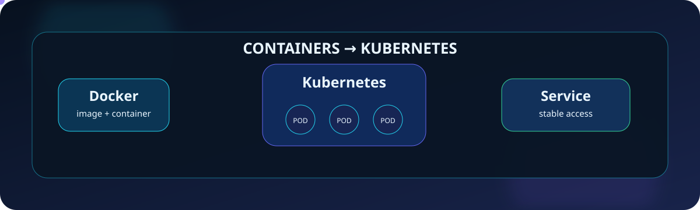
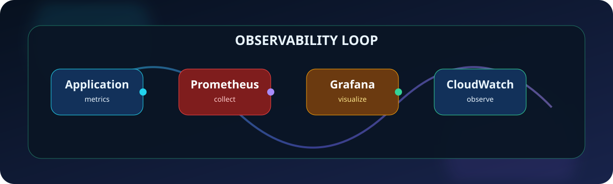
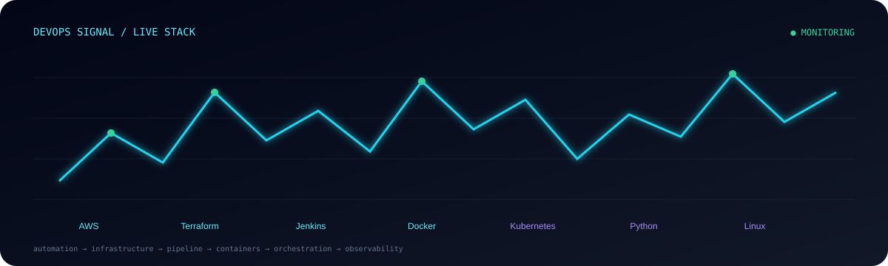

  <picture>
    <source media="(prefers-color-scheme: dark)" srcset="https://raw.githubusercontent.com/GovindSaiKrishnaRayarao/GovindSaiKrishnaRayarao/main/assets/govind-hero-dark.svg">
    <source media="(prefers-color-scheme: light)" srcset="https://raw.githubusercontent.com/GovindSaiKrishnaRayarao/GovindSaiKrishnaRayarao/main/assets/govind-hero-light.svg">
    
  </picture>

<h1 align="center">👋 Govind Sai Krishna Rayarao</h1>

  <strong>Junior DevOps / Cloud Engineer</strong>

  AWS • Terraform • Jenkins • Docker • Kubernetes • Linux • Python • CI/CD

  <em>I automate the manual steps and build repeatable cloud workflows.</em>

  
  &nbsp;&nbsp;
  
  &nbsp;&nbsp;
  

---

<h2>🪟 About Me</h2>

<table>
<tr>
<td width="60%" valign="top">

<h3>👋 Who I Am</h3>

I'm an aspiring <strong>DevOps / Cloud Engineer</strong> with a B.Tech in
<strong>Computer Science & Engineering – Data Science</strong>.

My focus is on building practical cloud and DevOps solutions using
<strong>AWS, Terraform, Jenkins, Docker, Kubernetes, Linux and Python</strong>.

I enjoy taking repetitive manual processes and turning them into
<strong>automated, version-controlled and repeatable workflows</strong>.

I'm currently strengthening my skills through hands-on projects involving
cloud infrastructure, CI/CD, containers, Kubernetes and monitoring.

</td>

<td width="40%" valign="top">

<h3>🧑‍💻 whoami</h3>

<pre>
name: Govind Sai Krishna Rayarao
role: Junior DevOps / Cloud Engineer
location: Hyderabad, India

education:
  degree: B.Tech CSE - Data Science
  period: 2021 - 2025

focus:
  - AWS
  - Terraform
  - CI/CD
  - Docker
  - Kubernetes
  - Linux
  - Python
</pre>

</td>
</tr>
</table>

---

<h2>📊 What I Work With</h2>

<table>
<tr>

<td width="25%" align="center">

<h3>☁️ Cloud</h3>

<strong>AWS</strong>

  

EC2 
VPC 
S3 
IAM 
RDS 
Lambda 
CloudWatch 
Route 53 
CloudFront 
EKS

</td>

<td width="25%" align="center">

<h3>🏗️ Infrastructure</h3>

<strong>Terraform</strong>

  

Infrastructure as Code 
Reusable Configurations 
VPC Provisioning 
EC2 Provisioning 
S3 Configuration 
IAM Configuration

</td>

<td width="25%" align="center">

<h3>🔄 CI/CD</h3>

<strong>Jenkins</strong>

  

Git 
GitHub 
Webhooks 
Build 
Test 
Deployment 
GitHub Actions

</td>

<td width="25%" align="center">

<h3>🐳 Containers</h3>

<strong>Docker + Kubernetes</strong>

  

Images 
Containers 
Dockerfiles 
Pods 
Deployments 
Services 
EKS Fundamentals

</td>

</tr>
</table>

---

<h2>🚀 What I've Built</h2>

  <em>My profile is centered around practical projects rather than just technology names.</em>

<table>
<tr>

<td width="50%" valign="top">

<h3>🏗️ AWS Infrastructure Provisioning</h3>

<strong>Terraform • AWS • EC2 • VPC • S3 • IAM</strong>

  

<strong>Built:</strong>

<ul>
<li>VPC infrastructure</li>
<li>EC2 resources</li>
<li>S3 storage</li>
<li>IAM policies and roles</li>
<li>Reusable Terraform configurations</li>
</ul>

<strong>Result:</strong>

Standardized infrastructure provisioning and improved provisioning
repeatability by approximately <strong>40%</strong>.

</td>

<td width="50%" valign="top">

<h3>🔄 Jenkins CI/CD Pipeline</h3>

<strong>Jenkins • GitHub • Git • Webhooks • Linux</strong>

  

<strong>Built:</strong>

<ul>
<li>GitHub → Jenkins integration</li>
<li>GitHub webhook trigger</li>
<li>Three-stage pipeline</li>
<li>Build automation</li>
<li>Testing workflow</li>
<li>Deployment workflow</li>
</ul>

<strong>Pipeline:</strong>

GitHub → Webhook → Jenkins → Build → Test → Deploy

</td>

</tr>

<tr>

<td width="50%" valign="top">

<h3>🐳 Container & Kubernetes Work</h3>

<strong>Docker • Kubernetes • Linux</strong>

  

<strong>Hands-on with:</strong>

<ul>
<li>Docker images</li>
<li>Docker containers</li>
<li>Dockerfiles</li>
<li>Containerized applications</li>
<li>Kubernetes Pods</li>
<li>Deployments</li>
<li>Services</li>
<li>EKS fundamentals</li>
</ul>

</td>

<td width="50%" valign="top">

<h3>🐍 Python Automation</h3>

<strong>Python • ETL • OCR • Data Processing</strong>

  

<strong>Built:</strong>

<ul>
<li>Python-based ETL workflow</li>
<li>Document data extraction</li>
<li>OCR processing</li>
<li>Image-based text extraction</li>
<li>Automated repetitive processing</li>
</ul>

<strong>Project:</strong> BHEL Project Internship

</td>

</tr>
</table>

---

<h2>🧩 My DevOps Workflow</h2>

  <picture>
    <source media="(prefers-color-scheme: dark)" srcset="https://raw.githubusercontent.com/GovindSaiKrishnaRayarao/GovindSaiKrishnaRayarao/main/assets/govind-pipeline-dark.svg">
    <source media="(prefers-color-scheme: light)" srcset="https://raw.githubusercontent.com/GovindSaiKrishnaRayarao/GovindSaiKrishnaRayarao/main/assets/govind-pipeline-light.svg">
    
  </picture>

<table>
<tr>
<td align="center"><strong>01</strong> Code</td>
<td align="center">→</td>
<td align="center"><strong>02</strong> Git / GitHub</td>
<td align="center">→</td>
<td align="center"><strong>03</strong> Webhook</td>
<td align="center">→</td>
<td align="center"><strong>04</strong> CI/CD</td>
<td align="center">→</td>
<td align="center"><strong>05</strong> Build & Test</td>
<td align="center">→</td>
<td align="center"><strong>06</strong> Deploy</td>
<td align="center">→</td>
<td align="center"><strong>07</strong> Monitor</td>
</tr>
</table>

---

<h2>☁️ Cloud & Infrastructure</h2>

  <picture>
    <source media="(prefers-color-scheme: dark)" srcset="https://raw.githubusercontent.com/GovindSaiKrishnaRayarao/GovindSaiKrishnaRayarao/main/assets/govind-cloud-dark.svg">
    <source media="(prefers-color-scheme: light)" srcset="https://raw.githubusercontent.com/GovindSaiKrishnaRayarao/GovindSaiKrishnaRayarao/main/assets/govind-cloud-light.svg">
    
  </picture>

<table>
<tr>

<td width="50%" valign="top">

<h3>☁️ AWS</h3>

<code>EC2</code> <code>VPC</code> <code>S3</code> <code>IAM</code>
<code>RDS</code> <code>Lambda</code>

<code>CloudWatch</code> <code>Route 53</code>
<code>CloudFront</code> <code>Auto Scaling</code>
<code>WAF</code> <code>EKS</code>

</td>

<td width="50%" valign="top">

<h3>🏗️ Terraform</h3>

<ul>
<li>Infrastructure as Code</li>
<li>Reusable configurations</li>
<li>VPC provisioning</li>
<li>EC2 provisioning</li>
<li>S3 configuration</li>
<li>IAM configuration</li>
</ul>

</td>

</tr>
</table>

---

<h2>🐳 Containers & Kubernetes</h2>

  <picture>
    <source media="(prefers-color-scheme: dark)" srcset="https://raw.githubusercontent.com/GovindSaiKrishnaRayarao/GovindSaiKrishnaRayarao/main/assets/govind-containers-dark.svg">
    <source media="(prefers-color-scheme: light)" srcset="https://raw.githubusercontent.com/GovindSaiKrishnaRayarao/GovindSaiKrishnaRayarao/main/assets/govind-containers-light.svg">
    
  </picture>

<table>
<tr>

<td width="50%" valign="top">

<h3>🐳 Docker</h3>

<ul>
<li>Docker Images</li>
<li>Docker Containers</li>
<li>Dockerfiles</li>
<li>Containerized Applications</li>
</ul>

</td>

<td width="50%" valign="top">

<h3>☸️ Kubernetes</h3>

<ul>
<li>Pods</li>
<li>Deployments</li>
<li>Services</li>
<li>Container Orchestration</li>
<li>EKS Fundamentals</li>
</ul>

</td>

</tr>
</table>

---

<h2>📈 Monitoring & Observability</h2>

  <picture>
    <source media="(prefers-color-scheme: dark)" srcset="https://raw.githubusercontent.com/GovindSaiKrishnaRayarao/GovindSaiKrishnaRayarao/main/assets/govind-observability-dark.svg">
    <source media="(prefers-color-scheme: light)" srcset="https://raw.githubusercontent.com/GovindSaiKrishnaRayarao/GovindSaiKrishnaRayarao/main/assets/govind-observability-light.svg">
    
  </picture>

<table>
<tr>

<td width="33%" align="center">

<h3>📊 Prometheus</h3>

Metrics collection and monitoring fundamentals.

</td>

<td width="33%" align="center">

<h3>📈 Grafana</h3>

Metrics visualization and dashboard fundamentals.

</td>

<td width="33%" align="center">

<h3>☁️ CloudWatch</h3>

AWS monitoring, metrics and troubleshooting.

</td>

</tr>
</table>

---

<h2>🏭 Industry Project</h2>

<table>
<tr>

<td width="30%" valign="top">

<h3>🏭 BHEL</h3>

<strong>Project Intern</strong>

  

May 2024 
June 2024

</td>

<td width="70%" valign="top">

<h3>Python-Based Document Data Extraction & OCR Automation</h3>

<strong>Python • ETL • OCR • Data Processing</strong>

  

<ul>
<li>Built a Python-based ETL workflow.</li>
<li>Processed document information.</li>
<li>Used OCR for image-based documents.</li>
<li>Extracted text from unstructured information.</li>
<li>Automated repetitive data-processing work.</li>
</ul>

</td>

</tr>
</table>

---

<h2>🧠 Python & Data Projects</h2>

<table>
<tr>

<td width="33%" valign="top">

<h3>📰 Fake News Detection</h3>

<strong>NLP • Machine Learning • Python</strong>

<ul>
<li>Text preprocessing</li>
<li>Feature extraction</li>
<li>NLP workflow</li>
<li>Classification</li>
</ul>

</td>

<td width="33%" valign="top">

<h3>😊 Emotion Detection</h3>

<strong>NLP • Machine Learning</strong>

<ul>
<li>Text preprocessing</li>
<li>Feature extraction</li>
<li>SVM</li>
<li>Decision Tree</li>
<li>Random Forest</li>
</ul>

</td>

<td width="33%" valign="top">

<h3>📊 Data Analysis</h3>

<strong>Python • Pandas • NumPy</strong>

<ul>
<li>Data preprocessing</li>
<li>EDA</li>
<li>Visualization</li>
<li>Dataset analysis</li>
</ul>

</td>

</tr>
</table>

---

<h2>🛠️ Technology Stack</h2>

  <picture>
    <source media="(prefers-color-scheme: dark)" srcset="https://raw.githubusercontent.com/GovindSaiKrishnaRayarao/GovindSaiKrishnaRayarao/main/assets/govind-stack-dark.svg">
    <source media="(prefers-color-scheme: light)" srcset="https://raw.githubusercontent.com/GovindSaiKrishnaRayarao/GovindSaiKrishnaRayarao/main/assets/govind-stack-light.svg">
    
  </picture>

<table>
<tr>

<td width="50%" valign="top">

<h3>☁️ Cloud & Infrastructure</h3>

<code>AWS</code>
<code>Terraform</code>
<code>EC2</code>
<code>VPC</code>
<code>S3</code>
<code>IAM</code>
<code>RDS</code>
<code>Lambda</code>
<code>CloudWatch</code>
<code>Route 53</code>
<code>CloudFront</code>
<code>EKS</code>

<h3>🔄 DevOps</h3>

<code>Jenkins</code>
<code>GitHub Actions</code>
<code>Git</code>
<code>GitHub</code>
<code>Webhooks</code>

</td>

<td width="50%" valign="top">

<h3>🐳 Containers & OS</h3>

<code>Docker</code>
<code>Kubernetes</code>
<code>Linux</code>
<code>Windows</code>
<code>Nginx</code>

<h3>🐍 Programming & Data</h3>

<code>Python</code>
<code>Bash</code>
<code>Shell</code>
<code>SQL</code>
<code>MySQL</code>
<code>Django</code>
<code>Pandas</code>
<code>NumPy</code>

<h3>📊 Observability</h3>

<code>Prometheus</code>
<code>Grafana</code>
<code>CloudWatch</code>

</td>

</tr>
</table>

---

<h2>🏅 Certification</h2>

<table>
<tr>

<td width="20%" align="center">

🎓

</td>

<td width="80%">

<h3>Microsoft Azure Fundamentals — AZ-900</h3>

<strong>Microsoft Azure • February 2024</strong>

  

Cloud concepts • Azure services • Architecture • Security • Governance • Pricing • Management

</td>

</tr>
</table>

---

<h2>🧭 Current Focus</h2>

<table>
<tr>

<td width="33%" align="center">

<h3>☁️ Cloud</h3>

AWS Infrastructure 
Terraform 
Cloud Security Fundamentals

</td>

<td width="33%" align="center">

<h3>⚙️ Automation</h3>

Jenkins 
GitHub Actions 
Python 
CI/CD

</td>

<td width="33%" align="center">

<h3>🚀 Platform</h3>

Docker 
Kubernetes 
Linux 
Monitoring

</td>

</tr>
</table>

 

<strong>AWS → Terraform → CI/CD → Docker → Kubernetes → Monitoring</strong>

---

<h2>📚 How I Learn</h2>

<table>
<tr>

<td align="center">
<strong>01</strong> 
Learn
</td>

<td align="center">→</td>

<td align="center">
<strong>02</strong> 
Build
</td>

<td align="center">→</td>

<td align="center">
<strong>03</strong> 
Break
</td>

<td align="center">→</td>

<td align="center">
<strong>04</strong> 
Troubleshoot
</td>

<td align="center">→</td>

<td align="center">
<strong>05</strong> 
Automate
</td>

<td align="center">→</td>

<td align="center">
<strong>06</strong> 
Document
</td>

</tr>
</table>

I prefer hands-on learning — building projects, understanding how components connect,
troubleshooting failures and documenting what I learn.

---

<h2>📊 GitHub Analytics</h2>

  
  

  

---

<h2>🐍 Contribution Graph</h2>

  

---

<h2>🎯 2026 Goals</h2>

<table>
<tr>

<td width="33%" valign="top">

<h3>☁️ Cloud</h3>

<ul>
<li>Strengthen AWS</li>
<li>Build production-style Terraform projects</li>
<li>Improve cloud security fundamentals</li>
</ul>

</td>

<td width="33%" valign="top">

<h3>⚙️ DevOps</h3>

<ul>
<li>Improve Jenkins</li>
<li>Improve GitHub Actions</li>
<li>Strengthen Docker</li>
<li>Improve Kubernetes</li>
</ul>

</td>

<td width="33%" valign="top">

<h3>🚀 Career</h3>

<ul>
<li>Build practical projects</li>
<li>Improve troubleshooting</li>
<li>Strengthen observability</li>
<li>Start my DevOps / Cloud career</li>
</ul>

</td>

</tr>
</table>

---

<h2>💼 Open to Opportunities</h2>

<table>
<tr>

<td width="60%" valign="top">

<h3>🎯 Roles</h3>

<ul>
<li>Junior DevOps Engineer</li>
<li>AWS Cloud Engineer</li>
<li>Cloud Support Engineer</li>
<li>Cloud Operations Engineer</li>
<li>DevOps Trainee</li>
<li>SRE / Cloud Support</li>
<li>AWS Cloud Intern</li>
</ul>

</td>

<td width="40%" valign="top">

<h3>📍 Preference</h3>

<strong>Hyderabad / Remote</strong>

  

Interested in opportunities involving:

  

Cloud Infrastructure 
Automation 
CI/CD 
Containers 
Reliability

</td>

</tr>
</table>

---

<h2>📡 Signal</h2>

  <picture>
    <source media="(prefers-color-scheme: dark)" srcset="https://raw.githubusercontent.com/GovindSaiKrishnaRayarao/GovindSaiKrishnaRayarao/main/assets/govind-signal-dark.svg">
    <source media="(prefers-color-scheme: light)" srcset="https://raw.githubusercontent.com/GovindSaiKrishnaRayarao/GovindSaiKrishnaRayarao/main/assets/govind-signal-light.svg">
    
  </picture>

---

<h2>🤝 Connect With Me</h2>

<table align="center">
<tr>

<td align="center">

 
<strong>GitHub</strong>

</td>

<td width="40"></td>

<td align="center">

 
<strong>LinkedIn</strong>

</td>

<td width="40"></td>

<td align="center">

 
<strong>Email</strong>

</td>

</tr>
</table>

---

  <picture>
    <source media="(prefers-color-scheme: dark)" srcset="https://raw.githubusercontent.com/GovindSaiKrishnaRayarao/GovindSaiKrishnaRayarao/main/assets/govind-end-dark.svg">
    <source media="(prefers-color-scheme: light)" srcset="https://raw.githubusercontent.com/GovindSaiKrishnaRayarao/GovindSaiKrishnaRayarao/main/assets/govind-end-light.svg">
    
  </picture>

  <strong>⚡ Automate the manual. Build the repeatable. Learn by doing.</strong>

  ⭐ Thanks for visiting my GitHub profile!

