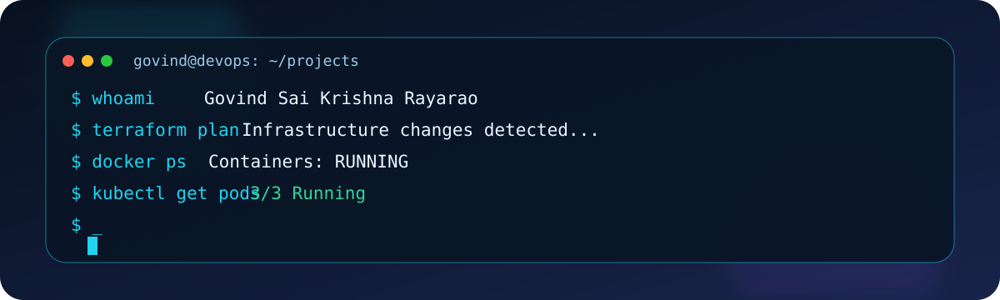
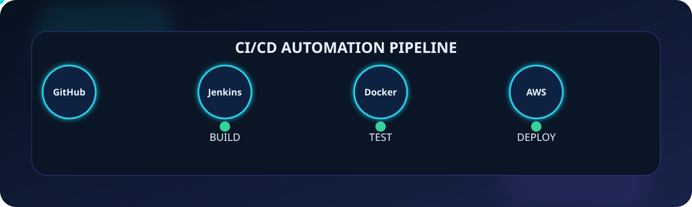
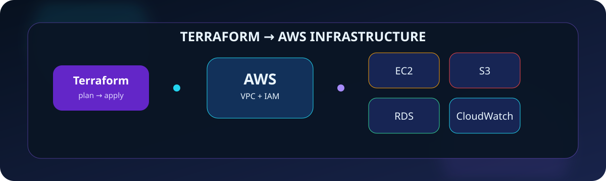
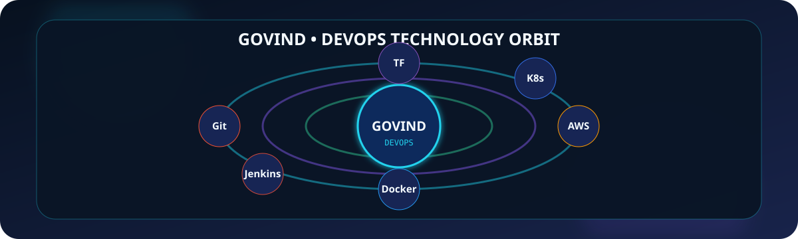
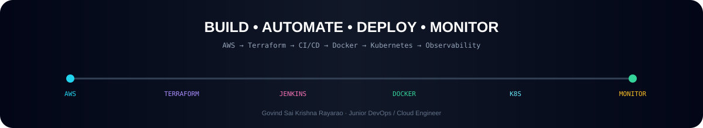

<p align="center">
  <picture>
    <source media="(prefers-color-scheme: dark)" srcset="https://raw.githubusercontent.com/GovindSaiKrishnaRayarao/GovindSaiKrishnaRayarao/main/assets/govind-hero-dark.svg">
    <source media="(prefers-color-scheme: light)" srcset="https://raw.githubusercontent.com/GovindSaiKrishnaRayarao/GovindSaiKrishnaRayarao/main/assets/govind-hero-light.svg">
    
  </picture>
</p>

<h1 align="center">👋 Govind Sai Krishna Rayarao</h1>

<p align="center">
  <strong>Junior DevOps / Cloud Engineer</strong>
</p>

<p align="center">
  AWS • Terraform • Jenkins • Docker • Kubernetes • Linux • Python • CI/CD
</p>

<p align="center">
  <em>I automate the manual steps and build repeatable cloud workflows.</em>
</p>

<p align="center">
  <a href="https://github.com/GovindSaiKrishnaRayarao">
    
  </a>
  &nbsp;&nbsp;
  <a href="https://www.linkedin.com/in/govind-sai-krishna-rayarao/">
    
  </a>
  &nbsp;&nbsp;
  <a href="mailto:govindsaikrishnarayao@gmail.com">
    
  </a>
</p>

---

# 🪟 About

I'm an aspiring **DevOps / Cloud Engineer** with a B.Tech in **Computer Science & Engineering – Data Science**.

My primary interests are:

- ☁️ AWS Cloud
- 🏗️ Infrastructure as Code with Terraform
- 🔄 CI/CD automation
- 🐳 Docker
- ☸️ Kubernetes
- 🐧 Linux
- 🐍 Python automation
- 📊 Monitoring and observability
- 🔐 Cloud infrastructure and security fundamentals

I enjoy taking repetitive manual processes and turning them into **automated, version-controlled and repeatable workflows**.

---

# 🖥️ `whoami`

<p align="center">
  <picture>
    <source media="(prefers-color-scheme: dark)" srcset="https://raw.githubusercontent.com/GovindSaiKrishnaRayarao/GovindSaiKrishnaRayarao/main/assets/govind-terminal-dark.svg">
    <source media="(prefers-color-scheme: light)" srcset="https://raw.githubusercontent.com/GovindSaiKrishnaRayarao/GovindSaiKrishnaRayarao/main/assets/govind-terminal-light.svg">
    
  </picture>
</p>

```yaml
name: Govind Sai Krishna Rayarao
role: Junior DevOps / Cloud Engineer
location: Hyderabad, India

education:
  degree: B.Tech CSE - Data Science
  period: 2021 - 2025

cloud:
  - AWS
  - Azure Fundamentals

infrastructure:
  - Terraform
  - EC2
  - VPC
  - S3
  - IAM

ci_cd:
  - Jenkins
  - GitHub Actions
  - Git
  - GitHub
  - Webhooks

containers:
  - Docker
  - Kubernetes

automation:
  - Python
  - Bash
  - Shell Scripting

observability:
  - Prometheus
  - Grafana
  - AWS CloudWatch
```

---

# 📊 By the Numbers

<p align="center">

| 🎓 Education | ☁️ Cloud | 🏗️ IaC | 🔄 CI/CD |
|:---:|:---:|:---:|:---:|
| B.Tech CSE | AWS | Terraform | Jenkins |
| Data Science | Azure Fundamentals | Infrastructure | GitHub Actions |

</p>

---

# 🧩 My DevOps Workflow

<p align="center">
  <picture>
    <source media="(prefers-color-scheme: dark)" srcset="https://raw.githubusercontent.com/GovindSaiKrishnaRayarao/GovindSaiKrishnaRayarao/main/assets/govind-pipeline-dark.svg">
    <source media="(prefers-color-scheme: light)" srcset="https://raw.githubusercontent.com/GovindSaiKrishnaRayarao/GovindSaiKrishnaRayarao/main/assets/govind-pipeline-light.svg">
    
  </picture>
</p>

```text
Developer
    ↓
Git / GitHub
    ↓
Webhook
    ↓
Jenkins / GitHub Actions
    ↓
Build
    ↓
Test
    ↓
Docker
    ↓
Deploy
    ↓
AWS
    ↓
Monitor
```

---

# ☁️ Cloud & Infrastructure

<p align="center">
  <picture>
    <source media="(prefers-color-scheme: dark)" srcset="https://raw.githubusercontent.com/GovindSaiKrishnaRayarao/GovindSaiKrishnaRayarao/main/assets/govind-cloud-dark.svg">
    <source media="(prefers-color-scheme: light)" srcset="https://raw.githubusercontent.com/GovindSaiKrishnaRayarao/GovindSaiKrishnaRayarao/main/assets/govind-cloud-light.svg">
    
  </picture>
</p>

### ☁️ AWS

`EC2` `VPC` `S3` `IAM` `RDS` `Lambda`

`CloudWatch` `Route 53` `CloudFront`

`Auto Scaling` `WAF` `EKS`

### 🏗️ Infrastructure as Code

`Terraform`

- Reusable configurations
- Infrastructure provisioning
- VPC configuration
- EC2 provisioning
- S3 configuration
- IAM configuration

---

# 🐳 Containers & Kubernetes

<p align="center">
  <picture>
    <source media="(prefers-color-scheme: dark)" srcset="https://raw.githubusercontent.com/GovindSaiKrishnaRayarao/GovindSaiKrishnaRayarao/main/assets/govind-containers-dark.svg">
    <source media="(prefers-color-scheme: light)" srcset="https://raw.githubusercontent.com/GovindSaiKrishnaRayarao/GovindSaiKrishnaRayarao/main/assets/govind-containers-light.svg">
    
  </picture>
</p>

```text
Application
     ↓
Dockerfile
     ↓
Docker Image
     ↓
Container
     ↓
Kubernetes
     ↓
Pod
     ↓
Service
```

### Docker

- Images
- Containers
- Dockerfiles
- Containerized applications

### Kubernetes

- Pods
- Deployments
- Services
- Container orchestration
- EKS fundamentals

---

# 📈 Monitoring & Observability

<p align="center">
  <picture>
    <source media="(prefers-color-scheme: dark)" srcset="https://raw.githubusercontent.com/GovindSaiKrishnaRayarao/GovindSaiKrishnaRayarao/main/assets/govind-observability-dark.svg">
    <source media="(prefers-color-scheme: light)" srcset="https://raw.githubusercontent.com/GovindSaiKrishnaRayarao/GovindSaiKrishnaRayarao/main/assets/govind-observability-light.svg">
    
  </picture>
</p>

```text
Application
     ↓
Metrics
     ↓
Prometheus
     ↓
Grafana
     ↓
CloudWatch
     ↓
Troubleshooting
```

### Tools

`Prometheus` `Grafana` `AWS CloudWatch`

---

# 🛠️ Technology Stack

<p align="center">
  <picture>
    <source media="(prefers-color-scheme: dark)" srcset="https://raw.githubusercontent.com/GovindSaiKrishnaRayarao/GovindSaiKrishnaRayarao/main/assets/govind-stack-dark.svg">
    <source media="(prefers-color-scheme: light)" srcset="https://raw.githubusercontent.com/GovindSaiKrishnaRayarao/GovindSaiKrishnaRayarao/main/assets/govind-stack-light.svg">
    
  </picture>
</p>

| Area | Technologies |
|---|---|
| ☁️ Cloud | AWS, Azure Fundamentals |
| 🏗️ IaC | Terraform |
| 🔄 CI/CD | Jenkins, GitHub Actions |
| 🐳 Containers | Docker |
| ☸️ Orchestration | Kubernetes |
| 🐧 OS | Linux, Windows |
| 🐍 Programming | Python, Bash, SQL |
| 🔀 Version Control | Git, GitHub |
| 📊 Monitoring | Prometheus, Grafana, CloudWatch |
| 🌐 Web | Nginx |
| 🗄️ Database | MySQL |

---

# 🎯 Featured Projects

## 1. AWS Infrastructure Provisioning Using Terraform

**AWS • Terraform • EC2 • VPC • S3 • IAM**

### What I built

- Configured VPC infrastructure
- Provisioned EC2 resources
- Configured S3 storage
- Created IAM policies and roles
- Created reusable Terraform configurations
- Standardized infrastructure deployment
- Improved provisioning repeatability by approximately **40%**

```text
Terraform
    ↓
AWS Provider
    ↓
VPC
 ┌──┴─────┐
EC2      S3
 │
IAM
 │
AWS Infrastructure
```

---

## 2. CI/CD Pipeline Automation Using Jenkins

**Jenkins • Git • GitHub • Webhooks • Linux**

### Pipeline

```text
GitHub Push
     ↓
Webhook
     ↓
Jenkins
     ↓
Build
     ↓
Test
     ↓
Deployment
```

### What I built

- GitHub and Jenkins integration
- GitHub webhook trigger
- Three-stage Build / Test / Deployment pipeline
- Automated builds
- Automated testing
- Deployment workflow
- Git-based version control

---

## 3. Docker & Kubernetes

**Docker • Kubernetes • Linux**

Hands-on work with:

- Docker images
- Docker containers
- Containerized applications
- Kubernetes pods
- Deployments
- Services
- Kubernetes fundamentals

---

# 🏭 BHEL Project

## Python-Based Document Data Extraction & OCR Automation

**Project Intern — BHEL**

**May 2024 – June 2024**

<p align="center">

```text
Documents
    ↓
Python
    ↓
Data Processing
    ↓
OCR
    ↓
Text Extraction
    ↓
Structured Data
```

</p>

### Work

- Built a Python-based ETL workflow
- Processed document information
- Used OCR for image-based documents
- Extracted text from unstructured information
- Automated repetitive data-processing work

---

# 🧠 Python & Data Projects

## 📰 Fake News Detection

**Python • NLP • Machine Learning**

- Text preprocessing
- Dataset preparation
- NLP
- Feature extraction
- Classification
- Machine learning workflow

## 😊 Emotion Detection

**Python • NLP • Machine Learning**

- Text preprocessing
- Feature extraction
- SVM
- Decision Tree
- Random Forest

## 📊 Data Analysis

**Python • Pandas • NumPy • Matplotlib • Seaborn**

- Data preprocessing
- Exploratory data analysis
- Visualization
- Dataset analysis

---

# 🏅 Certification

## Microsoft Azure Fundamentals — AZ-900

**Microsoft Azure • February 2024**

Knowledge areas include:

- Cloud concepts
- Azure services
- Azure architecture
- Security
- Governance
- Pricing
- Cloud management

---

# 🧭 Current Focus

```text
AWS
 ↓
Terraform
 ↓
Docker
 ↓
Jenkins
 ↓
Kubernetes
 ↓
Monitoring
 ↓
Cloud / DevOps Engineering
```

### Currently strengthening

- AWS infrastructure
- Terraform
- Jenkins
- GitHub Actions
- Docker
- Kubernetes
- Linux
- Prometheus
- Grafana
- CloudWatch
- Cloud security fundamentals

---

# 📚 How I Learn

```text
        LEARN
          ↓
        BUILD
          ↓
        BREAK
          ↓
     TROUBLESHOOT
          ↓
       AUTOMATE
          ↓
      DOCUMENT
          ↓
        REPEAT
```

I prefer **hands-on learning** — building projects, understanding how the components connect, breaking configurations, troubleshooting them and documenting what I learn.

---

# 📊 GitHub Analytics

<p align="center">
  
  
</p>

<p align="center">
  
</p>

---

# 🐍 Contribution Graph

<p align="center">
  
</p>

---

# 🎯 2026 Goals

- ☁️ Strengthen AWS cloud engineering
- 🏗️ Build production-style Terraform projects
- 🔄 Improve Jenkins and GitHub Actions
- 🐳 Strengthen Docker
- ☸️ Improve Kubernetes skills
- 📊 Improve observability
- 🐍 Build Python automation projects
- 🔐 Strengthen cloud security fundamentals
- 🚀 Start my professional DevOps / Cloud Engineering career

---

# 💼 Open to Opportunities

I'm currently interested in:

- Junior DevOps Engineer
- AWS Cloud Engineer
- Cloud Support Engineer
- Cloud Operations Engineer
- DevOps Trainee
- SRE / Cloud Support
- AWS Cloud Intern

📍 **Hyderabad / Remote**

I'm looking for opportunities where I can work with **cloud infrastructure, automation, CI/CD, containers and reliability-focused engineering**.

---

# 📡 Signal

<p align="center">
  <picture>
    <source media="(prefers-color-scheme: dark)" srcset="https://raw.githubusercontent.com/GovindSaiKrishnaRayarao/GovindSaiKrishnaRayarao/main/assets/govind-signal-dark.svg">
    <source media="(prefers-color-scheme: light)" srcset="https://raw.githubusercontent.com/GovindSaiKrishnaRayarao/GovindSaiKrishnaRayarao/main/assets/govind-signal-light.svg">
    
  </picture>
</p>

---

# 🤝 Connect With Me

<p align="center">

<a href="https://github.com/GovindSaiKrishnaRayarao">

</a>

&nbsp;&nbsp;&nbsp;

<a href="https://www.linkedin.com/in/govind-sai-krishna-rayarao/">

</a>

&nbsp;&nbsp;&nbsp;

<a href="mailto:govindsaikrishnarayao@gmail.com">

</a>

</p>

---

<p align="center">
  <picture>
    <source media="(prefers-color-scheme: dark)" srcset="https://raw.githubusercontent.com/GovindSaiKrishnaRayarao/GovindSaiKrishnaRayarao/main/assets/govind-end-dark.svg">
    <source media="(prefers-color-scheme: light)" srcset="https://raw.githubusercontent.com/GovindSaiKrishnaRayarao/GovindSaiKrishnaRayarao/main/assets/govind-end-light.svg">
    
  </picture>
</p>

<p align="center">
  <strong>⚡ Automate the manual. Build the repeatable. Learn by doing.</strong>
</p>

<p align="center">
  ⭐ Thanks for visiting my GitHub profile!
</p>
