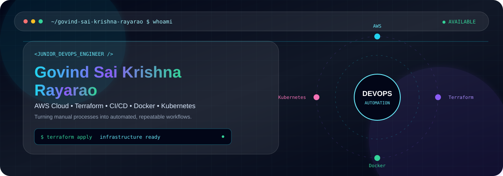

<p align="center">
  <picture>
    <source
      media="(prefers-color-scheme: dark)"
      srcset="https://raw.githubusercontent.com/GovindSaiKrishnaRayarao/GovindSaiKrishnaRayarao/main/govind-hero-dark.svg"
    >
    
  </picture>
</p>

<p align="center">
  <b>Govind Sai Krishna Rayarao</b>
  · DevOps Engineer
  · AWS Cloud
  · Terraform
  · Docker
  · CI/CD
</p>

<p align="center">

<a href="mailto:govindsaikrishnarayarao@gmail.com">
  
</a>

&nbsp;&nbsp;

<a href="https://www.linkedin.com/in/govind-sai-krishna-rayarao">
  
</a>

&nbsp;&nbsp;

<a href="https://github.com/GovindSaiKrishnaRayarao">
  
</a>

</p>

---

## 👋 Player 1

I'm an aspiring **DevOps Engineer** focused on **AWS Cloud, Terraform, Docker, Jenkins, Kubernetes, Linux, Python, and CI/CD automation**.

I enjoy turning manual processes into **automated, repeatable, and reliable workflows**, with a focus on infrastructure automation, cloud deployments, containerization, and continuous delivery.

My background also includes Python-based automation, data processing, and machine-learning projects, giving me a strong foundation in scripting, automation, and problem solving.

**Now playing:** Building practical AWS and DevOps projects while preparing for **Junior DevOps Engineer, Cloud Support Engineer, Cloud Engineer, and SRE / Cloud Operations opportunities**.

---

## ☁️ DevOps & Cloud Stack

### ☁️ Cloud

- [AWS](https://aws.amazon.com/)
- [Amazon EC2](https://aws.amazon.com/ec2/)
- [Amazon VPC](https://aws.amazon.com/vpc/)
- [Amazon S3](https://aws.amazon.com/s3/)
- [AWS IAM](https://aws.amazon.com/iam/)
- [Amazon RDS](https://aws.amazon.com/rds/)
- [AWS Lambda](https://aws.amazon.com/lambda/)
- [Amazon CloudWatch](https://aws.amazon.com/cloudwatch/)
- [Amazon Route 53](https://aws.amazon.com/route53/)
- [Amazon CloudFront](https://aws.amazon.com/cloudfront/)
- [AWS Auto Scaling](https://aws.amazon.com/autoscaling/)
- [AWS WAF](https://aws.amazon.com/waf/)
- [Amazon EKS](https://aws.amazon.com/eks/)
- [Microsoft Azure Fundamentals](https://learn.microsoft.com/credentials/certifications/azure-fundamentals/)

### 🏗️ Infrastructure as Code

- [Terraform](https://developer.hashicorp.com/terraform)
- Terraform Modules
- Variables & Outputs
- Security Groups
- VPC Infrastructure
- EC2 Provisioning
- RDS Integration
- Provisioners

### 🔄 CI/CD

- [Jenkins](https://www.jenkins.io/)
- [GitHub Actions](https://github.com/features/actions)
- GitHub Webhooks
- Build / Test / Deploy Pipelines
- Automated Terraform Workflows
- Environment-Based Deployments

### 🐳 Containers & Orchestration

- [Docker](https://www.docker.com/)
- [Kubernetes](https://kubernetes.io/)
- Pods
- Deployments
- Services
- ConfigMaps
- Secrets
- Ingress
- [Amazon EKS](https://aws.amazon.com/eks/)

### 📊 Monitoring & Observability

- [Amazon CloudWatch](https://aws.amazon.com/cloudwatch/)
- [Prometheus](https://prometheus.io/)
- [Grafana](https://grafana.com/)
- Alertmanager
- Node Exporter

### 🐧 Operating Systems & Automation

- [Linux](https://www.linux.org/)
- Bash
- [Python](https://www.python.org/)
- Shell Scripting
- Automation
- Troubleshooting

### 🔀 Version Control

- [Git](https://git-scm.com/)
- [GitHub](https://github.com/)
- [GitHub Actions](https://github.com/features/actions)

---

## 🛠️ Featured Projects

### 🔧 AWS Infrastructure with Terraform

Designed and automated AWS infrastructure using **Terraform**, including networking and compute resources.

The project focuses on infrastructure as code, repeatable provisioning, and AWS resource configuration.

**Technologies:**

`AWS` `Terraform` `VPC` `EC2` `S3` `IAM` `Security Groups`

---

### 🚀 Terraform + Jenkins CI/CD

Built an automated infrastructure deployment workflow using **Jenkins and Terraform**.

The pipeline connects source control, Jenkins automation, Terraform infrastructure operations, and AWS deployment workflows.

**Technologies:**

`Jenkins` `Terraform` `Git` `GitHub` `AWS` `CI/CD`

---

### 🐳 Docker & Kubernetes

Worked with containerized applications using **Docker** and explored application deployment and orchestration using **Kubernetes**.

Hands-on areas include:

- Docker images
- Docker containers
- Dockerfiles
- Kubernetes Pods
- Deployments
- Services
- Ingress
- ConfigMaps
- Secrets

**Technologies:**

`Docker` `Kubernetes` `Amazon EKS`

---

## 🏭 BHEL Automation Project

During my project internship at **BHEL**, I worked on replacing a manual data-collection workflow with a Python-based automated pipeline.

The solution used a **3-stage data/document processing workflow** to make the process more repeatable and reduce manual effort.

### Key areas

- Python automation
- Data extraction
- Web/data processing
- Document processing
- OCR
- Workflow automation
- Repeatable processing pipelines

**Technologies:**

`Python` `Requests` `BeautifulSoup` `OCR` `Automation`

---

## 🧠 Python & Data Projects

Before focusing primarily on DevOps, I worked on several Python and machine-learning projects.

### 📰 Fake News Detection

Built a machine-learning model for classifying news as real or fake using:

`Python` `TF-IDF` `N-Grams` `SVM`

### 🧠 Emotion Detection

Worked with NLP-based emotion classification using:

`Python` `NLP` `SVM` `Decision Tree` `Random Forest`

### 📱 Data Analysis

Analyzed mobile-phone specifications and pricing using Python-based data-analysis tools.

**Technologies:**

`Python` `Pandas` `NumPy` `Matplotlib` `Seaborn`

---

## 🎯 Currently Learning

```text
AWS Cloud
    ↓
Terraform
    ↓
Docker
    ↓
Jenkins / CI/CD
    ↓
Kubernetes
    ↓
Amazon EKS
    ↓
Monitoring & Observability
    ↓
DevOps / SRE
```

Currently strengthening my knowledge of:

- AWS architecture
- Terraform
- Jenkins
- GitHub Actions
- Docker
- Kubernetes
- Amazon EKS
- Prometheus & Grafana
- Linux administration
- Cloud troubleshooting
- Infrastructure automation

---

## 🏆 Certifications & Learning

- **Microsoft Azure Fundamentals (AZ-900)**
- GenAI Masterclasses
- Continuous hands-on learning in AWS & DevOps

---

## 📊 GitHub Activity

<p align="center">

<a href="https://github.com/GovindSaiKrishnaRayarao">
  
</a>

</p>

<p align="center">

<a href="https://github.com/GovindSaiKrishnaRayarao">
  
</a>

</p>

---

## 👻 Featured Repositories

### 🔧 Infrastructure & Terraform

**[terrafrom-project](https://github.com/GovindSaiKrishnaRayarao/terrafrom-project)**  
`Terraform` · `AWS` · `Infrastructure as Code`

---

### 🚀 Terraform CI/CD

**[terraformcicd](https://github.com/GovindSaiKrishnaRayarao/terraformcicd)**  
`Terraform` · `Jenkins` · `CI/CD` · `AWS`

---

### ⚙️ DevOps Projects

**[devops](https://github.com/GovindSaiKrishnaRayarao/devops)**  
`DevOps` · `Cloud` · `Automation`

---

### 👤 Profile & Projects

**[govind](https://github.com/GovindSaiKrishnaRayarao/govind)**  
`GitHub` · `Projects` · `DevOps`

---

## ⚡ Power-Ups

<p align="center">

<a href="https://aws.amazon.com/">

</a>

<a href="https://developer.hashicorp.com/terraform">

</a>

<a href="https://www.docker.com/">

</a>

<a href="https://kubernetes.io/">

</a>

<a href="https://www.jenkins.io/">

</a>

<a href="https://www.python.org/">

</a>

<a href="https://www.linux.org/">

</a>

<a href="https://git-scm.com/">

</a>

</p>

---

## 💼 Open to Opportunities

I'm currently interested in:

**Junior DevOps Engineer · AWS Cloud Engineer · Cloud Support Engineer · DevOps Intern · SRE / Cloud Operations**

📍 **Hyderabad, India**

📧 **[Email Me](mailto:govindsaikrishnarayarao@gmail.com)**

🔗 **[LinkedIn](https://www.linkedin.com/in/govind-sai-krishna-rayarao)**

💻 **[GitHub](https://github.com/GovindSaiKrishnaRayarao)**

---

<p align="center">

  <picture>
    <source
      media="(prefers-color-scheme: dark)"
      srcset="https://raw.githubusercontent.com/GovindSaiKrishnaRayarao/GovindSaiKrishnaRayarao/main/govind-end-dark.svg"
    >
    
  </picture>

</p>

<p align="center">
  <b>Automate. Deploy. Monitor. Improve.</b>
</p>
